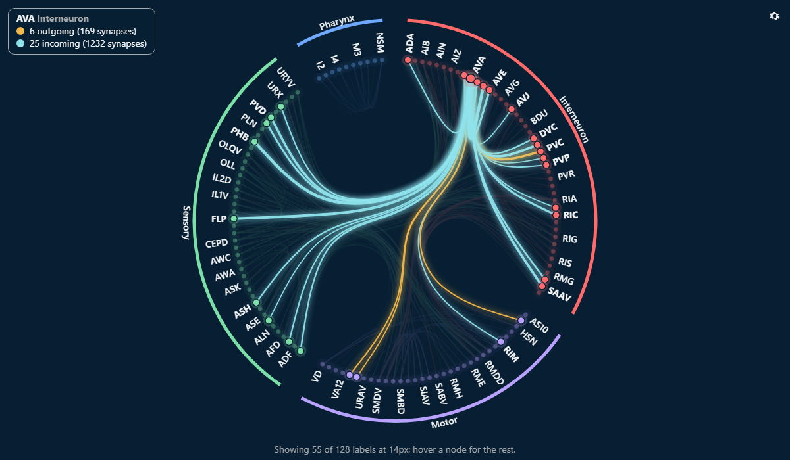

# Neurons: a Tableau viz extension

Hierarchical edge bundling for Tableau. Nodes sit on a circle, grouped by a
parent dimension, and every link is a curve that bends in through its group
hubs, so the dense web of a network collapses into readable bundles. Hover a
node and its links light up: outgoing in one colour, incoming in another, the
rest eased down to a whisper. It is free, MIT licensed, and runs in the free
edition of Tableau Desktop.

The default look is a neuron or synapse feel inside the Data Divers palette:
deep navy, soft glowing nodes, coral, lilac and mint groups, amber and aqua
for the lit links.



## What it does

- **Four Marks card shelves**: Group (the parent), Source, Target and an
  optional Weight. Four is the most Tableau allows a viz extension.
- **One row is one link.** Each node takes the group of the rows where it is
  the Source. A node that is only ever a Target takes its group from an
  optional detail column named like `TargetGroup`, otherwise it lands in
  "(no group)".
- **Real hierarchical edge bundling**: `d3.cluster` on a radial tree, links
  drawn with `d3.lineRadial` and `curveBundle`. The **beta** stepper runs from
  0 (straight chords) to 1 (tight bundles).
- **Hover a node**: its outgoing and incoming links light in two colours, with
  a glow and a small synapse bulb at the far end, and every other link eases
  down. The fade is easeInOut, and a hover that changes mid-fade starts from
  what is on screen. Click pins a node and selects its marks in Tableau.
- **Readable labels, always**: radial, never upside down, 14px or larger.
  When they cannot all fit, the ones with the lightest links are left out (you can change the priority) and a note
  under the chart says how many. Text is never shrunk below 14px to squeeze
  more in.
- **Group arcs** go around the outside, with the group name set along the arc.
- **38 settings** in 7 groups, in a panel that opens from the gear: layout,
  links, hover and click, nodes, labels, colours, the panel itself.
- **Text at 7 to 1 contrast** on whatever background it sits on. If a
  worksheet background is a mid tone where no ink can reach that, the chart
  paints its own white or navy plate instead of shipping unreadable labels.
- **No sliders.** Every number is a stepper you can type into. No browser
  dialogs either: "Paste settings" opens an inline box.
- **Settings are saved in the workbook** through Tableau's extension settings,
  and **Copy settings** puts the same values on the clipboard as JSON, which is
  what the C-Tableau Viz pages flow accepts.

## What else you need

| You need | Why |
| --- | --- |
| **Tableau Desktop 2024.2 or newer** | Viz extensions need 2024.2 at minimum. Free Edition works. |
| **Node.js** (or Python 3) | Tableau loads the extension from a local server. `Start-Neurons.bat` needs nothing but Windows PowerShell. |
| **One file from Tableau** | The Extensions API library. It is Tableau's, so it is not in this folder: [lib/README.md](lib/README.md) shows where to get it. The d3 modules are already here, vendored in `lib/d3` (ISC licence, no CDN at runtime). |

**Tableau Public: you can author with it, but viewers will not see it.** A
self-hosted `.trex` loads in Tableau Public Desktop, but visitors to the
published viz see "isn't currently supported on Tableau Public", because Public
only runs Tableau-approved Exchange extensions. For a public audience, use the
C-Tableau Viz pages, which host the extension for you, or put the page in a
dashboard Web Page object.

## Install

1. Download Tableau's library into `lib/` ([lib/README.md](lib/README.md)).
2. Start the server: double-click `Start-Neurons.bat` (port 8774), or
   `npm install && npm start`. Leave it running while Tableau uses the chart.
3. In Tableau: Marks card, mark type dropdown, **Viz Extensions**, **Add
   Extension**, **Access Local Viz Extensions**, pick `neurons.trex`. Click
   Allow.
4. Drop your fields on **Group**, **Source**, **Target** and, if you have
   one, **Weight**. Hover the chart and click the gear for every setting.

Tableau reads `neurons.trex` only when the extension is added. After editing
the manifest, remove the extension and add it again.

## Example data

`data/celegans-connectome.csv` is the wiring of the C. elegans nematode:
chemical synapses between its neuron classes, 128 nodes and 400 links. Nodes
are grouped Sensory, Interneuron, Motor and Pharynx.

| Column | Goes on |
| --- | --- |
| Group | Group |
| Source | Source |
| Target | Target |
| Synapses | Weight |
| TargetGroup | Detail (optional, gives target-only nodes a group) |

Credit: synapse counts are from Cook et al. 2019, "Whole-animal connectomes of
both Caenorhabditis elegans sexes", Nature 571:63-71, through the MIT-licensed
OpenWorm ConnectomeToolbox. Cell types are from WormAtlas. Left and right
pairs and numbered sets (DA1 to DA9) are merged into classes and counts summed.
`tools/build_example_data.py` rebuilds the file from those two sources.

## Use it without Tableau

Open `dev/dev.html` from the running server (`http://localhost:8774/dev/dev.html`).
It runs the shipping code against a mock of the Extensions API, with six
datasets chosen to break things: the real example, a tiny one, a 420-node
stress set, one full of blanks and self links, one with no group column, and
an empty one. Drag the stage corner to test resize.

## Tests

```bash
node test/run.js          # layout, schema and colour maths, no browser
python test/render.py     # Playwright render gates, headless Chromium
```

`node test/run.js` examines about 19,000 subjects: the graph build, the radial
cluster, every bundled curve at five beta values staying inside the circle and
ending on its nodes, beta actually changing the bend, label selection never
overlapping (rotated rectangles) and never upside down, the 14px floor, the
note, the no-slider schema, and 7 to 1 text contrast on sixteen backgrounds.

`python test/render.py` draws the chart at 300x300, 900x600 and 1600x1000 in
light and dark and checks the DOM itself: canvas painted, one dot per node, no
console errors, no label overlaps (taken from `getBBox` and the screen
transform, not from the layout code), every text node 14px or more, labels at
7 to 1, no scroll. It then drives hover (frame by frame, to prove the fade is
eased), click and selection, the settings panel, six data shapes, resize, and
the C-Tableau Viz pages stand-in.

Every gate declares a minimum subject count and goes red below it.

## What is and is not proven

Proven here: everything above, in a browser, against the mock and against the
real Viz pages stand-in (`standin.js`).

Not proven yet: loading in real Tableau Desktop. Row tuple ids for the hover
push, and `selectMarksByValueAsync` field names, follow the documented API but
have not been exercised against Tableau itself. The Viz pages stand-in has no
`hoverTupleAsync` and a no-op `selectMarksByValueAsync`, so on a Viz page hover
and selection stay inside the chart and nothing is pushed anywhere.

## Layout

```
neurons.trex            the manifest (port 8774)
src/index.html          the page Tableau loads
src/js/layout.js        pure maths: graph, cluster, bundling, label fit
src/js/render.js        canvas links, SVG nodes and labels, the eased fade
src/js/settings-*.js    the schema and the gear panel
src/js/palettes.js      colour maths and the 7 to 1 theme resolver
src/js/neurons.js       the Tableau adapter
lib/d3/                 vendored d3-path, d3-shape, d3-hierarchy and licences
dev/                    mock Tableau API, fixtures, harness
test/                   run.js (node) and render.py (Playwright)
data/                   the example
```

## License

MIT for this extension. The vendored d3 modules are ISC, Mike Bostock; their
licences sit beside them in `lib/d3`.
