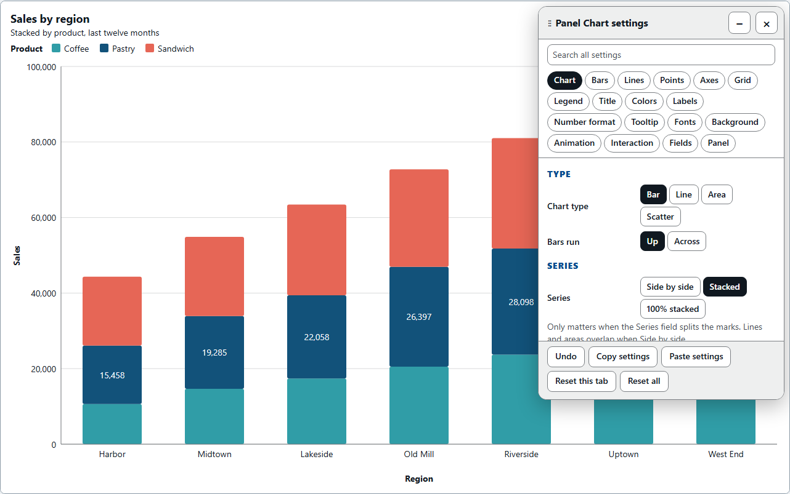
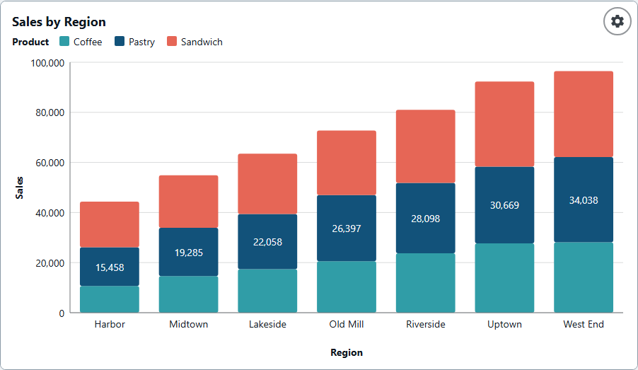
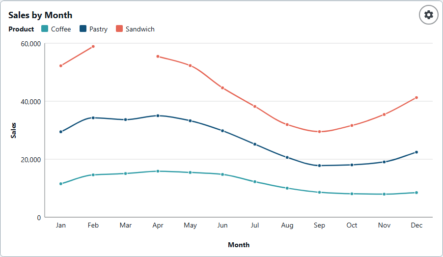
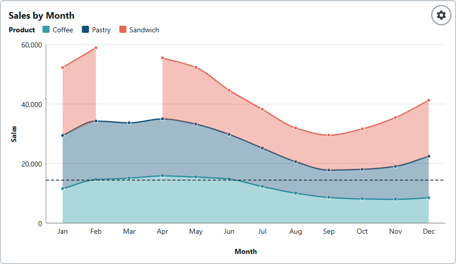
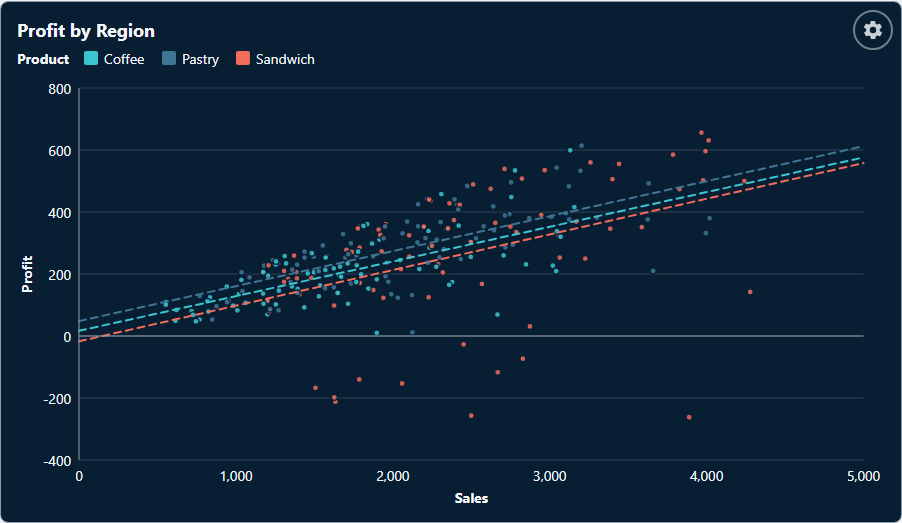

# Panel Chart

A general-purpose Tableau viz extension: bar, line, area and scatter in one chart, where the C-Tableau settings
panel is the point. Drop fields on four shelves, then click the gear and shape everything else by hand. Free, MIT.

| Bar | Line | Area | Scatter |
| --- | --- | --- | --- |
|  |  |  |  |

**Status:** proven in Chromium against a mock of the Tableau Extensions API (the gates below). It has NOT been
loaded in real Tableau Desktop yet. The manifest follows the shape that loads in Tableau Public Desktop 2026.1 for
our other extensions (`email=""`, `min-api-version` 1.12, `worksheetContent`), but that is not the same as a test.

## Shelves (Marks card encodings)

| Shelf | Takes | What it does |
| --- | --- | --- |
| Category | one dimension | the category axis: one bar, point or line vertex per value |
| Value | one measure | bar length, line height, point height |
| Color | one dimension, optional | splits the marks into series: side by side, stacked or 100% stacked |
| X value | one measure, optional | scatter X axis. Without it a scatter plots each category as a column of points |

## Settings (99 settings, 17 tabs)

| Tab | What is in it |
| --- | --- |
| Chart | type (bar, line, area, scatter), bars up or across, series side by side, stacked or 100%, combine rows (sum, average, smallest, largest, count), sort (data, largest, smallest, name, my order), reverse, first N, a category list to rename, hide, reorder or color one category |
| Bars | gap between categories, gap inside a group, widest bar, corner radius, outline, strength |
| Lines | width, straight, smooth (monotone, never overshoots) or steps, dashed or dotted, dots, missing values as a gap or zero, area fill strength and top line |
| Points | size, shape (circle, square, diamond, triangle), strength, ring, trend line for each series |
| Axes | each axis on or off, titles and their text, most ticks, start at zero, a custom range, axis lines |
| Grid | value and category lines, strength, solid, dashed or dotted, a reference line (average, median or a value) |
| Legend | on or off, top, bottom or right, the Series field name, square, circle or line keys |
| Title | title, size, weight, alignment, subtitle and its size |
| Colors, Labels, Number format, Tooltip, Fonts, Background, Animation, Interaction, Fields | the standard C-Tableau tabs: palette (Data Divers plus six colorblind-safe sets) and per-series colors and names, axis and value labels, decimals, separators, short form, prefix and suffix, tooltip size, swatches and placement, sans-serif fonts, background, border, padding, transition length and easing, hover dimming, click selects in Tableau, send hover to Tableau, hover guide line, pick any field by hand |

Rules the chart keeps on its own: text is never under 14px; every text is 7:1 against the color it sits on (a
text color you pick is pushed until it reaches 7:1, value labels go inside a stacked bar only when they fit at 7:1); every mark and legend key is at least 3:1 against the background (a palette color that would sink into a dark background is lifted);
axis labels are thinned or cut with an ellipsis, never shrunk, and no two texts overlap; no sliders anywhere; marks
glide to their new place on every change; no network call at runtime and every file is local.

## Run it

1. Double-click `Start-PanelChart.bat` (serves this folder on http://localhost:8778). See `START-HERE.txt`.
2. In Tableau: Marks card > Viz Extensions > Add Extension > Access Local Viz Extensions > `panel-chart.trex`.

Without Tableau: serve the folder (`python -m http.server 8778`) and open `dev/dev.html`. It runs the shipping code
against `dev/mock-tableau.js` with eight datasets (`?fixture=sales|monthly|scatter|single|negative|many|long|empty`,
`&size=900x520`, `&theme=dark`, `&bare=1`).

## Tests

| Command | What it proves |
| --- | --- |
| `node test/run.js` | the schema (99 settings, no range type, no em dash, text sizes floor at 14), aggregation, every sort, stacking and 100% stacks, nice ticks, text fitting, and 1,008 layouts (7 datasets, 4 types, 10 setting variants, 4 sizes, light and dark): every text 14px or more, inside the frame, 7:1 on its own background, no two touching |
| `python test/browser_test.py` | Chromium: every type in light and dark plus 18 stress cases (painted text boxes: 14px, 7:1, no overlap, inside the frame, marks with real size, no console error, no dialog, no request off this machine); the panel (gear, drag clamps, live redraw, copy and paste, Escape, 14px and 7:1 on every tab in light and dark, no range input); 390px sheets; hover, tooltip and selection; every setting flipped once must change the output; frame timing of six transitions; no em dash in source or on screen |
| `python test/sabotage.py` | breaks each gate's subject once (20 sabotages), requires RED, restores byte-exact (sha256), ends with both gates GREEN |
| `python tools/make_previews.py` | rewrites the pictures in `preview/` |

`python ../shared/ctab-panel/sync_check.py` checks `lib/ctab-panel/` is a byte-exact copy of the shared panel.
