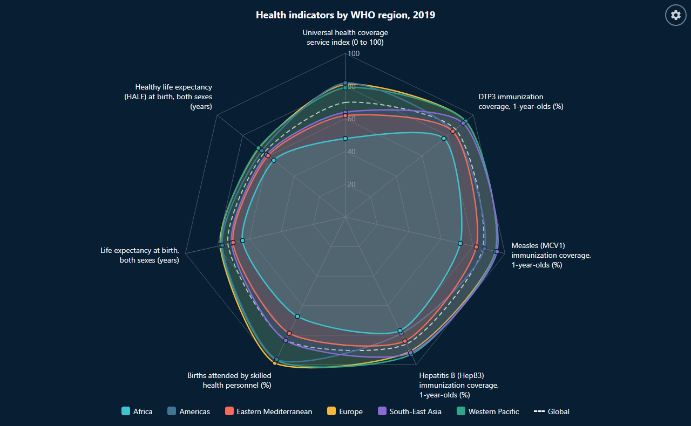

# Radar: a Tableau viz extension

A radar (spider) chart extension for Tableau, requested by Celia Fryar and built by Chris Fryar. It adds Radar as a
mark type on the Marks card: one spoke per Axis value, one outline per Series value, with a floating settings panel
inside the viz. It is free, it is MIT licensed, and it runs in the free edition of Tableau Desktop.



Radar charts can be hand-built in Tableau, and other radar extensions may exist. This one was asked for by name, so
it aims to be the most complete: the settings below, no sliders, and every text at 14px or larger.

## What it does

- **Four Marks card shelves**: Axis (one spoke per value, at least 3), Value (the number plotted), Series (optional,
  one outline per value), Label (optional display name for each axis).
- **Overlay or small multiples** (a chip). Small multiples gives each series its own radar, named above it, and picks
  the number of columns that makes the radars biggest. Type a number to set the columns yourself.
- **Straight or smoothed outlines.** Smoothed is a closed cardinal curve with a smoothness stepper; the curve is clamped
  so it never leaves the outer ring.
- **Filled or outline only**, fill opacity, line width, dots and value labels.
- **One shared scale or each axis its own.** Shared keeps axes comparable; per-axis stretches each spoke from its own
  lowest to highest value, and the rings then read as a share of that range. Centre value (zero, lowest, custom) and
  outer ring (rounded up, custom) are settable.
- **Rings**: 1 to 10 rings, polygon or circle, solid, dashed or dotted, tinted bands, ring value labels.
- **Axis labels wrap at a width you set, up to a number of lines you set, at 14px or larger.** If the chart is too
  small for every label, fewer are drawn and a note says "Showing 5 of 7 axis labels". The type is never shrunk to
  make room.
- **A benchmark or target**: pick one of the series (it leaves the series list and is drawn as a dashed ring), or type
  one value for every axis. Name, dash style, width, colour and tint are settable.
- **Sort the axes** (data order, name, average, or your own order from a list on the Axes tab) and the series, rotate the chart, run the axes clockwise or
  counter-clockwise.
- **Hover highlights a series and dims the others with an eased fade; click isolates it** (click again, or click the
  background, to release). The legend does the same. Selection and hover go back into Tableau.
- **A floating settings panel** (the same one as the other Data Divers extensions): click the gear, drag the panel by its
  title bar, minimize it, Escape closes it. It has 16 tabs and 95 settings: Layout, Rings, Axes, Series, Benchmark,
  Legend, then Marks, Colors (the Data Divers palette plus six colour-blind-safe ones, per-series overrides), Labels,
  Number format, Tooltip, Fonts, Background and border, Animation, Interaction, Fields. It has a search box, Reset
  this tab, Reset all, Undo, **Copy settings** and **Paste settings**. Below 420px wide it becomes a full-frame sheet.
- **No sliders.** Numbers are typed steppers, choices are chips and dropdowns, colours are colour inputs. No browser
  dialogs.
- **Settings are saved in the workbook** through Tableau's extension settings, and Copy settings produces the JSON the
  C-Tableau Viz pages accept.
- Sans-serif only, 14px minimum, text at 7:1 contrast against the background (it picks dark or light text from the
  worksheet background), works from 300 by 300 up to 1600 by 1000, no horizontal scroll, and an eased entrance
  (turn it off on the Animation tab; it also respects the system reduced-motion setting).

## What else you need

| You need | Why |
| --- | --- |
| Tableau Desktop 2024.2 or newer | Viz extensions need the 1.12 Extensions API. The free edition works. |
| Windows PowerShell | `Start-Radar.bat` serves the folder on `http://localhost:8776`. |
| Nothing else | The Tableau API library and the settings panel are in `lib/`, the radar maths is in `src/js`. No CDN, no npm install. |

**Tableau Public: you can author with it, but viewers will not see it.** A self-hosted `.trex` loads in Tableau
Public Desktop, but visitors to the published viz see "isn't currently supported on Tableau Public", because
Public only runs Tableau-approved Exchange extensions. For a public audience use the C-Tableau Viz pages (the
hosted stand-in runs this same code) or the single-file page from `tools/build_standalone.py`.

## Install

1. Double-click `Start-Radar.bat` and leave the window open.
2. In Tableau: Marks card > mark type dropdown > Viz Extensions > Add Extension > Access Local Viz Extensions >
   pick `radar.trex`. Click Allow.
3. Drag a dimension onto Axis and a measure onto Value. Optionally a dimension onto Series.

Tableau reads the `.trex` only when you add the extension, so after editing it, remove and re-add the extension.

## Use it in a workbook

Each Axis and Series pair should be one row of data. If a pair arrives more than once the chart averages it, so
aggregate in Tableau first if you want a different statistic. Try it on
`example/who-health-2019.csv`: Indicator on Axis, Value on Value, WHO region on Series, Indicator long name on
Label. The data are credited in `example/README.md`.

## Troubleshooting

| What you see | Why |
| --- | --- |
| "A radar needs at least 3 axes" | The Axis dimension has fewer than 3 values. Pick a dimension with 3 or more. |
| "Axis labels are hidden: the chart is too small" | There is no room for 14px labels. Enlarge the chart; labels are never made smaller. |
| "Showing 5 of 7 axis labels" | Labels would overlap. Make the viz bigger, wrap them onto more lines (Labels tab), or shorten the names with the Label shelf. |
| One outline collapses to the centre | Its values are missing. Missing values can sit at the centre or be skipped (Layout tab, Missing values). |
| Every series looks the same shape | They share one scale and are close in value. Try Each axis its own on the Rings tab. |
| Blank in a PDF or PowerPoint export | Tableau draws all viz extensions blank in those exports. |
| Two tooltips | Tableau's own tooltip shows when Send hover to Tableau is on. Turn it off on the Interaction tab, or clear the Marks card Tooltip. |
| Text is lower contrast on a grey sheet | On a mid-grey background 7:1 is mathematically out of reach (black reaches about 4.7:1), so it uses the best of black or white. |

## Try it without Tableau

`dev/dev.html` runs the shipping code against a mock of the Tableau API. Serve the folder (for example
`python -m http.server 8776`) and open `http://localhost:8776/dev/dev.html?fixture=who&size=900x520&theme=dark`.
Fixtures: who (real data), many (12 axes), manyseries, longnames, negative, holes, tiny, constant, two, empty.

`python tools/build_standalone.py --data example/who-health-2019.csv --axis "Indicator" --series "WHO region" --value "Value" --label "Indicator long name" --settings example/dark-settings.json --out standalone/index.html`
writes one self-contained page. `python tools/make_thumbnail.py OUT.png` captures the catalog thumbnail.

## Tests

```
node test/run.js              # unit checks: radar maths, scales, smoothing, label wrapping, layout, settings schema
python test/mock_render.py    # browser: 28 cases at 3 sizes in light and dark, hover fade, selection, panel, settings round trip, entrance
python test/standin_test.py   # the hub's real stand-in file drives it, five settings shapes, plus the standalone page
python test/sabotage.py       # breaks one thing at a time, shows the gate go RED, restores byte-exact, shows GREEN
python ../shared/ctab-panel/sync_check.py   # lib/ctab-panel must match shared/ctab-panel byte for byte
```

Every gate prints what it examined and goes RED if it examined too little.

## What I have and have not checked in Tableau

- Checked: the unit maths, the rendering in Chromium against a mock of the Extensions API (every feature listed above),
  and the C-Tableau Viz pages stand-in.
- **Not checked in real Tableau Desktop yet**: loading the `.trex`, the four shelves, summary data arriving one row
  per mark, `selectMarksByValueAsync` selecting the right marks, `hoverTupleAsync`, and settings surviving a save and
  reopen. The mock follows the published API, which is not the same as proof. Test these before relying on it.
- The Viz pages stand-in has no `selectTuplesAsync` or `hoverTupleAsync` and its selection calls do nothing, so on a
  viz page the chart draws, hovers, isolates and shows its own tooltip, but a click cannot filter anything.

## Layout

```
radar.trex                 the manifest (port 8776, id com.datadivers.vizext.radar)
src/index.html             the page Tableau loads
src/js/radar-math.js       scales, angles, smoothing, label wrapping, small-multiples layout (pure)
src/js/settings.js         the Radar rows of the settings schema (the panel's standard tabs come from ctab-panel)
src/js/render.js           the SVG radar, hover, isolate, tooltip, entrance
src/js/radar.js            the Tableau adapter
lib/                       Tableau's extensions library and the vendored shared settings panel (ctab-panel)
dev/                       mock Tableau API and harness
example/                   who-health-2019.csv and dark-settings.json, credited in example/README.md
test/  tools/  preview/
```

## Credit and license

Requested by Celia Fryar. MIT. See the repository `LICENSE`. `lib/tableau.extensions.1.latest.min.js` is Tableau's own
library (MIT). The example data are from the WHO Global Health Observatory (CC BY-NC-SA 3.0 IGO).
