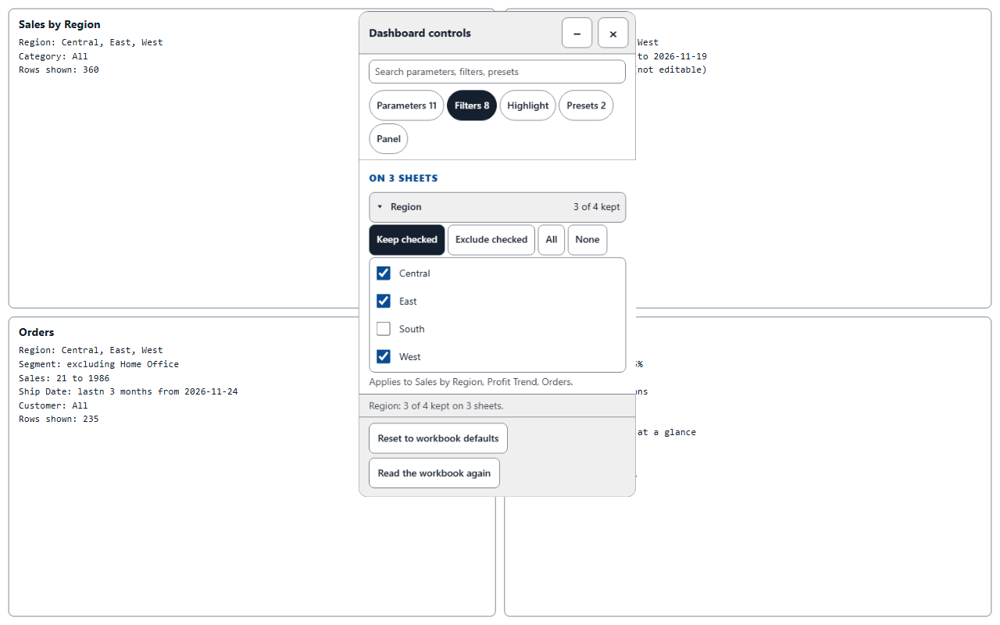
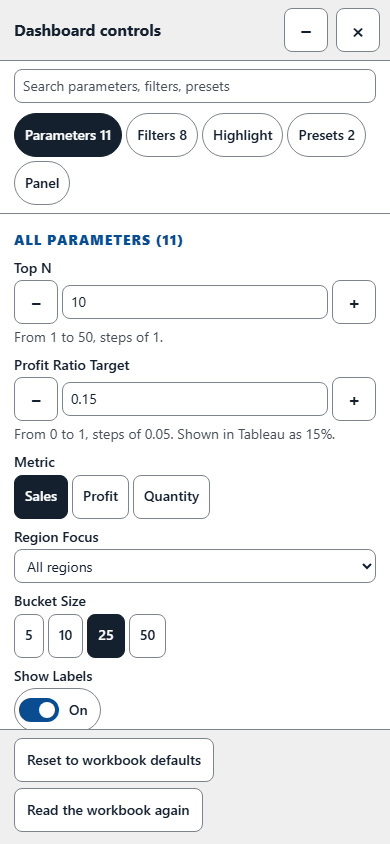
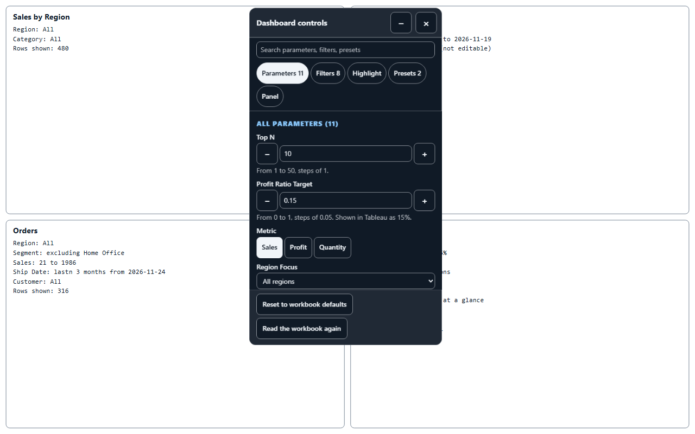

# Settings Panel: a Tableau dashboard extension

A floating gear you drop on any dashboard. Click it and one panel holds every parameter in the workbook, every filter
on every sheet of the dashboard, mark highlighting and named presets. Free for everyone, MIT licensed.

It is a **dashboard extension** (Objects pane > Extension), not a viz extension. It controls the dashboard around it.

## What it does

| Tab | What is in it |
|---|---|
| Parameters | Every parameter, with the control that fits its type: chips for a short list, a dropdown for a long one, an On/Off switch for yes/no, a typed stepper for numbers (range parameters keep their own min, max and step), a typed date with a stepper that moves by the parameter's own period (days, months, years), a text field for open strings. Never a slider. |
| Filters | Every filter on every worksheet, grouped by sheet. A filter that sits on several sheets (the usual "all using this data source") becomes one control that drives every copy, listed first under "On 3 sheets". Categorical: a checklist with Keep checked or Exclude checked, All, None, and a find box when there are more than 12 values (the first 200 matches show). Range: From and To as typed steppers on a 1-2-5 step, Include empty values, Show everything. Dates in a range are typed dates. Relative date: Previous, This, Next, Last N, Next N, To date, the period, how many, and the anchor date, read back in words ("next 4 weeks, counting from 2026-11-17"). Hierarchical (cube) filters are listed and say they cannot be edited. |
| Highlight | Per sheet: pick a text field, check values, and Tableau dims the rest (it selects those marks). One switch spreads the same highlight to every sheet that has the field. Clear highlight. |
| Presets | Save the current view under a name. Apply, Rename and Delete each preset, all inline (no browser dialogs; delete asks first). Presets are stored in the workbook's extension settings, so they travel with the `.twb`/`.twbx` to anyone who opens it. "Make the current view the default" sets what Reset returns to. |
| Panel | Theme: Match my system, Light, Dark or Custom. Every theme keeps text at 7:1 or better (the shared ctab-panel theme function). Grow the zone when the panel opens. Open width and height. Put the panel back top right. |

Across every tab:

- **Search** one box for parameters, filters, sheets and presets, wherever they live. Controls found by search work in place.
- **Reset to workbook defaults** (with an inline confirm). The first time the extension loads it captures the view as
  it stands, so Reset always returns somewhere true. Only what differs is sent to Tableau, one call at a time.
- **The gear state**: closed, the panel is a 40px gear. If the extension is a floating object, its zone shrinks to
  56 by 56 when closed and grows to the panel when open, keeping its right edge, so it never covers the dashboard
  while it is not in use.
- **Keyboard**: Enter on the gear opens it, Left and Right arrows move between tabs (Home and End too), Up and Down
  step any number or date field, Enter sends a typed value, Escape closes and puts focus back on the gear, and the
  arrow keys on the title bar move the panel.
- **Batched writes**: five quick clicks on a stepper become one Tableau call, so the dashboard re-queries once.
- **Under 420px wide** it becomes a full-frame sheet with 44px touch targets. Text is never under 14px.
- **No network calls.** Every file it loads sits beside it. Nothing is fetched at runtime, which is what the
  Tableau Exchange sandbox (and Tableau Public's sandboxed-extension rule) requires.

## Run it

1. Double-click `Start-SettingsPanel.bat`. It serves this folder on http://localhost:8777. Leave the window open.
2. In Tableau Desktop 2024.2 or newer: on a dashboard, set new objects to Floating, drag **Extension** onto the
   dashboard, then **Access Local Extensions** > `settings-panel.trex`.
3. Click the gear. `START-HERE.txt` has the same steps for sharing the folder.

To try it without Tableau: serve the folder (`python -m http.server 8777`) and open
http://localhost:8777/dev/dev.html. That page is a mock dashboard with three worksheets, eleven parameters of every
type and eight filters of every type; the sheet cards show what the panel did to the workbook.

## How it is built

| File | Job |
|---|---|
| `settings-panel.trex` | the manifest: `<dashboard-extension>`, `email=""` (Public Desktop refuses a manifest without it), min API 1.12, a Configure menu item that opens the panel |
| `src/js/model.js` | pure logic, no DOM: reads parameters and filters into controls, applies changes through the API, captures and restores whole views, presets, search. Runs under node for the unit gate. |
| `src/js/panel.js` | the floating panel. It wears the shared ctab-panel look (`lib/ctab-panel/ctab-panel.css`, the cp-* classes) and its 7:1 theme function; its rows come from the live workbook |
| `src/js/app.js` | boot, events (ParameterChanged, FilterChanged), first-run defaults, zone resizing |
| `dev/mock-dashboard.js` | a stand-in for the Dashboard Extensions API (strings-only settings, one summary reader per sheet, events after every write, refuses values a parameter does not allow) |

Calls newer than API 1.12 (`moveAndResizeDashboardObjectsAsync`, `applyRelativeDateFilterAsync`) are feature-checked
and skipped with a plain message when Tableau does not have them.

## Tests

| Command | What it proves |
|---|---|
| `node test/run.js` | 71 checks: every parameter type gets the right control and every write lands in the mock workbook; every filter type is read and written on every sheet that carries it; highlight reads through one released reader; presets and defaults round-trip through string settings exactly; search; date stepping; no em dash, no range input and no network call in any shipping file; the manifest is a dashboard extension with `email=""` |
| `python test/browser_test.py` | 116 checks in 14 groups in Chromium: render and zone sizing, every parameter control, every filter control, highlight, presets (including reopening from saved settings), reset, search, keyboard, the 14px floor and 7:1 contrast on every tab in light, dark and custom themes, no overlapping text at dashboard size and at 390, the 390 sheet rules, frame timing (median, p95 and longest frame), and no slider, dialog or em dash in rendered text. `--only group,group` runs some; `--shots DIR` saves a screenshot. |
| `python test/sabotage.py` | breaks 20 things one at a time (each gate's subject), requires the named gate to go RED, restores each file byte-exact (sha256), then requires both gates GREEN |
| `python tools/make_previews.py` | writes the four pictures in `preview/` |

## Not proven yet

It has not been loaded in real Tableau Desktop. Every check above runs against the mock, which is built from Tableau's
published type declarations. In particular these are unverified in Tableau: the exact values `applyFilterAsync`
accepts for non-text fields (it sends the values as strings), date parameters set from a `YYYY-MM-DD` string, the zone
resize on a floating extension, and Tableau Public behavior. It also has not been through the Tableau Exchange sandbox
review; it is built to pass it (no network calls, all assets local).
