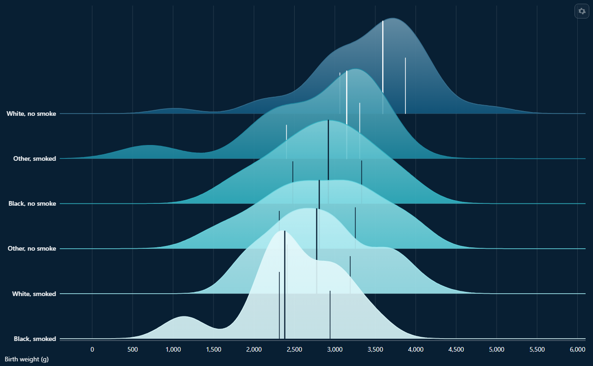
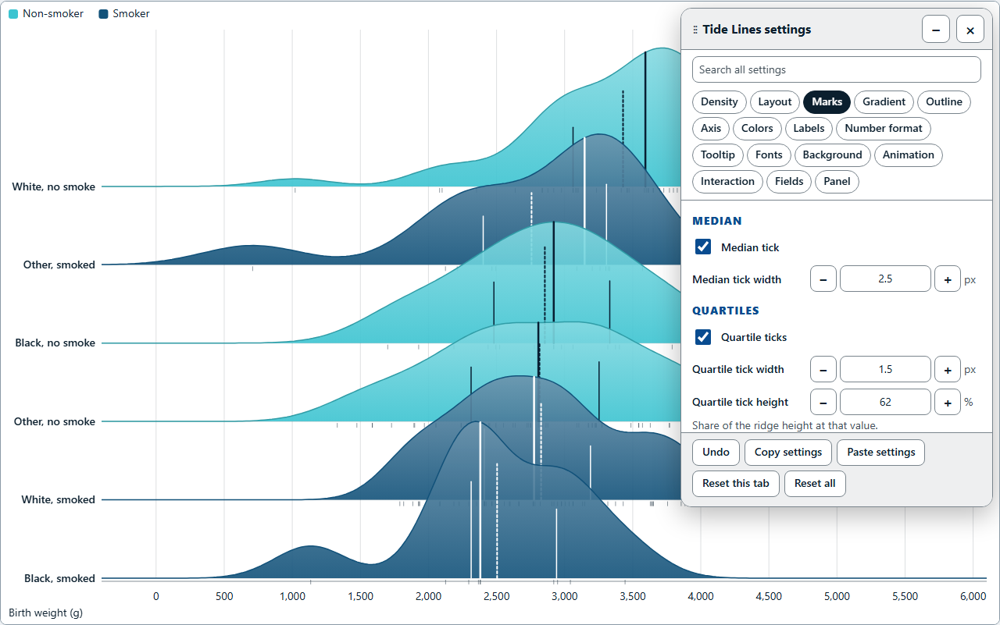

# Tide Lines: a Tableau viz extension

A ridgeline (joy plot) extension I built for Tableau. It adds Tide Lines as a mark type on the Marks card: one
smoothed density ridge per category, stacked and overlapping on a shared scale, filled with an ocean-tide
gradient. Every choice is adjustable from a floating settings panel that opens from a gear inside the viz. It is free, it
is MIT licensed, and it runs in the free edition of Tableau Desktop.



## What it does

- **Four Marks card shelves**: Category (one ridge per value), Value (the number whose distribution is drawn, one
  row per observation), Colour (optional), Label (optional display name for each ridge).
- **A kernel density estimate per category** on one shared x scale, so ridges compare honestly. Kernel chips:
  Gaussian or Epanechnikov.
- **Bandwidth is a stepper you can type into.** Empty (Auto) uses Silverman's rule of thumb, worked out for each
  ridge. Type a number to use one bandwidth for all of them. The bandwidth is in Gaussian-equivalent units, so
  switching kernel keeps the same amount of smoothing.
- **Overlap is a typed stepper**: how many ridge spacings tall a peak is (default 2).
- **Ocean-tide fill** from the Data Divers palette (deep navy, teal, foam), with two more palettes and a one-colour
  option. Or colour ridges by a field on the Colour shelf.
- **Median, quartile and mean ticks**, each switchable, with their own widths, heights and colour; an optional mark for every observation.
- **Sort chips**: data order, median, name, average, count, or your own order from the Colors tab list. A reverse switch flips any of them.
- **Hover lifts a ridge** with an eased move while the others dim, and a tooltip shows n, median and IQR.
  Click selects the ridge's marks in Tableau; Ctrl or Shift click adds.
- **Labels sit on the left at 14px or larger.** If the ridges are too tight for every label, fewer labels are
  drawn and the footer says "Showing 12 of 60 labels". The type is never shrunk to make room.
- **Shared height scale or each its own**, trim tails to the data, vertical grid, axis title.
- **Settings are saved in the workbook** through Tableau's extension settings, and **Copy settings** produces the
  JSON the C-Tableau Viz pages accept.
- **No sliders.** Numbers are typed steppers, choices are chips and dropdowns, colours are colour inputs. No
  browser dialogs.
- Sans-serif only, 14px minimum, text at 7:1 contrast against the background (it picks dark or light text from the
  worksheet background), works from 300 by 300 up to 1600 by 1000, no horizontal scroll.

## Settings



The gear in the corner opens a floating panel (the shared `ctab-panel` library, vendored in `lib/ctab-panel/`). Drag it
by its title bar; it stays inside the chart. Minimize it to the title bar, close it, or press Escape. A search box
filters every tab. **Copy settings** puts all 98 settings on the clipboard as flat JSON and **Paste settings** applies
JSON (validated, nothing changes on a bad paste); both work with the C-Tableau Viz pages flow. Reset this tab, Reset all
and Undo are in the panel. Numbers are typed steppers, never sliders, and no browser dialogs open.

| Tab | Settings | What is in it |
|---|---|---|
| Density | 7 | Kernel, Bandwidth, Bandwidth adjust, Ridge height, Tails, Room past the data, Curve detail |
| Layout | 9 | Sort ridges, Reverse order, Overlap, Draw a line under each ridge, Baseline strength, Names go on the, Name column up to, Say when names are left out, Show the colour legend |
| Marks | 10 | Median tick, Median tick width, Quartile ticks, Quartile tick width, Quartile tick height, Mean tick, Tick color, Mark every observation under its ridge, Observation tick height, Observation tick strength |
| Gradient | 8 | Ridge colour, Tide palette, One colour, Reverse the tide, Fill opacity, Fade each ridge from crest to base, Crest lightening, Fade out at the base |
| Outline | 7 | Outline width, Outline color, Custom outline color, Line style, Outline strength, Corners, Outline width on hover or select |
| Axis | 10 | Most ticks, Draw the axis line, Vertical grid, Grid strength, Grid line, Axis title, Axis title text, Axis range, Axis starts at, Axis ends at |
| Colors | 3 | Palette for By field, Reverse the palette order, Colors and names |
| Labels | 7 | Show labels, Label size, Label weight, Label color, Wrap onto up to, Show value labels, Value label size |
| Number format | 6 | Least decimal places, Thousands separator, Short form (1.2K, 3.4M), Multiply by, Prefix, Suffix |
| Tooltip | 5 | Show tooltips, Tooltip text size, Color swatch beside each name, Placement, Maximum width |
| Fonts | 5 | Font, Show a title, Title text, Title size, Title weight |
| Background | 7 | Background, Background color, Padding, Draw a border, Border color, Border width, Corner radius |
| Animation | 4 | Animate the chart, Duration, Easing, Hover fade |
| Interaction | 6 | Hover lift, Dim unselected ridges to, Click selects marks in Tableau, Highlight on hover, Dim the others to, Send hover to Tableau |
| Fields | 4 | Category field, Value field, Colour field, Label field |

Old workbooks keep their look: the keys `animate`, `bgMatch`, `inkAuto`, `inkColor` and `selectEnabled`, and a font saved
as a CSS stack, are read as fallbacks for `animOn`, `bgMode`, `labelColor`, `selectOn` and `fontFamily`.
Every other saved key is unchanged. **Send hover to Tableau** is still on the Interaction tab and still defaults on.

## What else you need

| You need | Why |
| --- | --- |
| Tableau Desktop 2024.2 or newer | Viz extensions need the 1.12 Extensions API. The free edition works. |
| Windows PowerShell | `Start-TideLines.bat` serves the folder on `http://localhost:8775`. |
| Nothing else | The Tableau API library is in `lib/` and the density maths is in `src/js`. No CDN, no npm install. |

**Tableau Public: you can author with it, but viewers will not see it.** A self-hosted `.trex` loads in Tableau
Public Desktop, but visitors to the published viz see "isn't currently supported on Tableau Public", because
Public only runs Tableau-approved Exchange extensions. For a public audience use the C-Tableau Viz pages (the
hosted stand-in runs this same code) or the single-file page from `tools/build_standalone.py`.

## Install

1. Double-click `Start-TideLines.bat` and leave the window open.
2. In Tableau: Marks card > mark type dropdown > Viz Extensions > Add Extension > Access Local Viz Extensions >
   pick `tide-lines.trex`. Click Allow.
3. Drag a dimension onto Category and a measure onto Value.

Tableau reads the `.trex` only when you add the extension, so after editing it, remove and re-add the extension.

## Use it in a workbook

One mark must be one observation. Put the row identifier on Detail (or turn off Analysis > Aggregate Measures) so
Tableau sends every row instead of one summed number per category. Try it on `example/birth-weight.csv`: Mother
group on Category, Birth weight (g) on Value, Baby ID on Detail, Mother smoked in pregnancy on Colour, Short name on
Label.

## Troubleshooting

| What you see | Why |
| --- | --- |
| Every ridge is one identical narrow hill | Each category arrived as a single summed row. Put the row id on Detail. |
| "Showing 8 of 60 labels" | The ridges are closer together than a 14px label needs. Make the viz taller, reduce Overlap, or filter. Labels are never made smaller than 14px. |
| One ridge is a lone hill while the others are spread out | That category has one row, or every value is the same. Silverman's rule has no spread to work with, so it borrows the typical bandwidth of the other ridges. |
| Blank in a PDF or PowerPoint export | Tableau draws all viz extensions blank in those exports. |
| Two tooltips | Tableau's own tooltip shows because Send hover to Tableau is on. Turn it off on the Interaction tab of the panel (Send hover to Tableau), or clear the Marks card Tooltip. |
| Text is lower contrast on a grey sheet | On a mid-grey background 7:1 is mathematically out of reach (black reaches about 4.7:1), so it uses the best of black or white. |

## Try it without Tableau

`dev/dev.html` runs the shipping code against a mock of the Tableau API. Serve the folder (for example
`python -m http.server 8775`) and open `http://localhost:8775/dev/dev.html?fixture=birth&size=900x520&theme=dark`.
Fixtures: typical, birth (real data), many (60 ridges), long, tiny, constant, empty.

`python tools/build_standalone.py --data example/birth-weight.csv --category "Mother group" --value "Birth weight (g)" --color "Mother smoked in pregnancy" --label "Short name" --settings example/dark-settings.json --out standalone/index.html`
writes one self-contained page. `python tools/make_thumbnail.py OUT.png` captures the catalog thumbnail.

## Tests

```
node test/run.js              # 153 unit checks: density, Silverman, quantiles, sorting, layout, label fitting, contrast, the settings schema, old-key fallbacks
python test/mock_render.py    # browser: 18 cases, 324 checks: 3 sizes in light and dark, hover, selection, the panel (drag, minimize, close, Escape, Copy and Paste, 14px, 7:1), every one of the 98 settings flipped once and the output compared, an old workbook
python test/standin_test.py   # the hub's real stand-in file drives it (10 pages, 97 checks), five settings shapes, plus the standalone page
python test/sabotage.py       # breaks 13 things one at a time, shows each gate go RED, restores byte-exact, ends GREEN
python ../shared/ctab-panel/sync_check.py   # lib/ctab-panel is a byte-exact copy of the shared library
```

Every gate prints what it examined and goes RED if it examined too little. Each was shown to fail by breaking its
subject once (see the notes in the commit).

## What I have and have not checked in Tableau

- Checked: the unit maths, the rendering in Chromium against a mock of the Extensions API (every feature listed above),
  and the C-Tableau Viz pages stand-in.
- **Not checked in real Tableau Desktop yet**: loading the `.trex`, the four shelves, summary data arriving one row
  per mark, `selectMarksByValueAsync` selecting the right marks, `hoverTupleAsync`, and settings surviving a save and
  reopen. The mock follows the published API, which is not the same as proof. Test these before relying on it.
- The Viz pages stand-in has no `selectTuplesAsync` or `hoverTupleAsync` and its selection calls do nothing, so on a
  viz page the chart draws, hovers and shows its own tooltip, but clicking a ridge cannot filter anything.

## Layout

```
tide-lines.trex            the manifest (port 8775, id com.datadivers.vizext.tidelines)
src/index.html             the page Tableau loads
src/js/kde.js              density, Silverman, quantiles, sorting, ticks (pure)
src/js/layout.js           rows, label fitting, tick picking (pure)
src/js/palettes.js         colour maths, the Data Divers tide ramps, 7:1 contrast
src/js/settings.js         every setting, its default and its control (a ctab-panel schema), plus the old-key fallbacks
src/js/render.js           the SVG ridgeline, hover, selection, tooltip
lib/ctab-panel/           the shared floating settings panel (byte-exact copy of shared/ctab-panel)
src/js/tidelines.js        the Tableau adapter
dev/                       mock Tableau API and harness
example/                   birth-weight.csv and dark-settings.json, credited in example/README.md
test/  tools/  preview/
```

## License

MIT. See the repository `LICENSE`. `lib/tableau.extensions.1.latest.min.js` is Tableau's own library (MIT).
